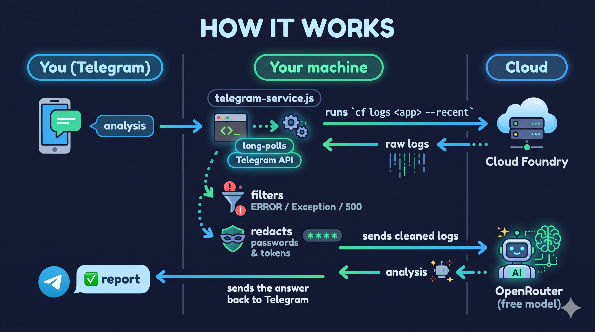

# SAP-Log-Assistant-
An AI-powered Telegram assistant that investigates SAP CAPM Cloud Foundry logs, identifies root causes, pinpoints probable files, and suggests fixes in seconds.

> Ask your Telegram bot for **"analysis"** and get an AI-powered root-cause report of your SAP CAP (CAPM) app's Cloud Foundry logs, right on your phone.

<p align="center">
  
</p>

<p align="center">
  <em>AI-generated production log analysis delivered instantly through Telegram.</em>
</p>

---

## 📌 Purpose

When a SAP CAPM app misbehaves in production, the usual routine is: open a terminal → `cf logs <app> --recent` → scroll through hundreds of lines → guess the root cause.

This small Node.js module automates that:

1. You send `analysis` to your Telegram bot.
2. The bot fetches the latest Cloud Foundry logs of your CAPM app.
3. It filters the error lines, redacts secrets, and sends them to a **free LLM on OpenRouter**.
4. You get a short, structured answer in Telegram:

```
🚨 Error:      what failed
🔍 Root Cause: why it failed
📂 File:       which project file (only if the logs prove it)
📍 Line:       line number (only if present in the stack trace)
🛠 Fix:        what to do
⚠ Severity:   Low / Medium / High
```

If there are no errors, it simply replies `✅ No errors found.`

---

## ⚙️ How it works



```
 You (Telegram)            Your machine                       Cloud
 ──────────────      ──────────────────────────      ─────────────────────
  "analysis"  ─────▶  telegram-service.js
                       │ long-polls Telegram API
                       │
                       ├─ runs `cf logs <app> --recent` ───▶  Cloud Foundry
                       │◀──────────────── raw logs ─────────
                       │
                       ├─ filters ERROR / Exception / 500 …
                       ├─ redacts Bearer tokens / passwords
                       │
                       ├─ sends cleaned logs to LLM ────────▶  OpenRouter (free model)
                       │◀────────────── analysis ───────────
                       │
  report ◀──────────── └─ sends the answer back to Telegram
```

Key features:

- ✅ Supports **multiple bots / multiple users** (each with its own allowed chat ID)
- ✅ Only **whitelisted chat IDs** can trigger analysis
- ✅ Secrets (`Bearer …`, `password`, `token`, `secret`) are **redacted** before leaving your machine
- ✅ **Duplicate-instance guard** (a local port lock) so two copies never fight over the same bot (Telegram `409` error)
- ✅ Prevents parallel analysis runs per chat
- ✅ No webhook or public URL needed, it uses long-polling

---

## 📋 Prerequisites

| Requirement | Notes |
|---|---|
| Node.js 16+ | Already present in any CAP project |
| [Cloud Foundry CLI (`cf`)](https://docs.cloudfoundry.org/cf-cli/install-go-cli.html) | Must be installed **and logged in** on the machine running the bot |
| A Telegram account | To create the bot |
| An OpenRouter account | Free, to get an API key |

> ⚠️ **Important:** the module calls the `cf` CLI, so it must run on a machine (laptop, VM, server) where `cf` is installed and logged in. It will **not** work inside a Cloud Foundry container, which has no `cf` CLI.

---

## 📦 Installation

### 1. Copy the file
Put `telegram-service.js` in your CAP project, for example in the `srv/` folder.

### 2. Install the required npm package

```bash
npm install axios
```

That's the only external dependency. `net` and `child_process` are built into Node.js.

### 3. Log in to Cloud Foundry

```bash
cf login --sso
```

(Re-run this whenever the session expires, the bot will tell you on Telegram when that happens.)

---

## 🔑 Step 1: Create a Telegram bot and get the token

1. Open Telegram and search for **[@BotFather](https://t.me/BotFather)**.
2. Send `/newbot`.
3. Choose a **name** (display name) and a **username** (must end with `bot`, e.g. `my_capm_logs_bot`).
4. BotFather replies with a token like:

   ```
   123456789:AAExampleTokenExampleTokenExample
   ```

5. Copy it. **Treat it like a password.**

## 🆔 Step 2: Get your Telegram chat ID

**Option A: using the bot API (recommended)**

1. Open your new bot in Telegram and send it any message (e.g. `hi`).
2. Open this URL in a browser (replace `<TOKEN>`):

   ```
   https://api.telegram.org/bot<TOKEN>/getUpdates
   ```

3. Find `"chat":{"id":123456789, ...}`. That number is your **chat ID**.

**Option B: using a helper bot**
Send any message to **[@userinfobot](https://t.me/userinfobot)**. It replies with your ID.

> For **group chats**, add the bot to the group, send a message, and call `getUpdates`. Group IDs are negative (e.g. `-1001234567890`).

Each teammate who wants access creates their own bot (or shares one) and adds their chat ID to the config.

---

## 🧠 Step 3: Get a free OpenRouter model

1. Sign up at **[openrouter.ai](https://openrouter.ai)**.
2. Go to **[Keys](https://openrouter.ai/keys)** → **Create Key** → copy it (`sk-or-v1-...`).
3. Browse free models: **[openrouter.ai/models?max_price=0](https://openrouter.ai/models?max_price=0)**. Free models have the **`:free`** suffix in their ID, e.g. `provider/model-name:free`.
4. Copy the model ID and put it in the `model` field inside `analyzeLogs()`:

   ```js
   model: "provider/model-name:free",
   ```

Tips:

- Free models are **rate-limited** (requests per minute/day), and the list changes often. If you get a `404` or `429` error, pick another `:free` model.
- Reasoning models may return the answer in a `reasoning` field. The script already falls back to it.
- Log lines are sent to a third-party LLM. Don't use this on logs containing sensitive customer data without reviewing your company's policy.

---

## 🔎 Step 4: Find your `capm_srv_app` name

This is the **name of your deployed CAP server application** in Cloud Foundry, the one whose logs you want to analyze.

**Method 1: `cf apps` (easiest)**

```bash
cf target      # confirm you're in the right org / space
cf apps
```

Example output:

```
name                      requested state   routes
myproject-srv             started           myproject-srv.cfapps.eu10.hana.ondemand.com
myproject-db-deployer     stopped
myproject-app-router      started           ...
```

→ Use the **`-srv`** one: `myproject-srv`.

**Method 2: `mta.yaml`**

```yaml
modules:
  - name: myproject-srv      # ← this is your app name
    type: nodejs
    path: gen/srv
```

**Method 3: BTP Cockpit**
Subaccount → Space → **Applications** → pick the one ending in `-srv`.

---

## 🛠 Step 5: Configure

Open `telegram-service.js` and edit the config block. **Do not commit real keys to GitHub** (see the security section below).

```js
const capm_srv_app = "myproject-srv";               // from Step 4
const OPENROUTER_API_KEY = process.env.OPENROUTER_API_KEY;

const BOTS_CONFIG = [
  {
    name: "me",
    token: process.env.TG_TOKEN_1,                  // from Step 1
    chats: [process.env.TG_CHAT_1],                 // from Step 2
    app: capm_srv_app
  },
  // add more users / bots here
];
```

Set the environment variables before starting (use a `.env` file or your shell):

```bash
# Linux / macOS
export OPENROUTER_API_KEY="sk-or-v1-..."
export TG_TOKEN_1="123456789:AAE..."
export TG_CHAT_1="123456789"

# Windows PowerShell
$env:OPENROUTER_API_KEY="sk-or-v1-..."
$env:TG_TOKEN_1="123456789:AAE..."
$env:TG_CHAT_1="123456789"
```

Also update the **"You can only refer to these project files"** list in the system prompt so it matches **your** CAP project's file names. This stops the model from inventing files.

---

## 🚀 Step 6: Use it in your CAPM project

### Option A: from `srv/server.js` (recommended)

Create (or edit) `srv/server.js`:

```js
const cds = require("@sap/cds");

// Start the Telegram log-analyzer bot together with the CAP server
require("./telegram-service");

module.exports = cds.server;
```

### Option B: from a service implementation

At the top of any service file, e.g. `srv/disposal-management-service.js`:

```js
require("./telegram-service");

module.exports = async (srv) => {
  // ... your handlers
};
```

### Option C: run it standalone

```bash
node srv/telegram-service.js
```

Then start your app as usual:

```bash
cds watch
```

You should see:

```
[boot] telegram-service loaded, pid=12345, ...
Telegram CAPM Bot Started... pid=12345
[me] OK -> @my_capm_logs_bot, chats: 123456789
[me] polling started
```

---

## 💬 Usage

Open your bot in Telegram and send:

| Command | What it does |
|---|---|
| `help` or `/start` | Shows usage |
| `analysis` | Fetches recent logs, runs AI analysis, replies with the report |

Example reply:

```
🚨 Error: SQLITE_CONSTRAINT: UNIQUE constraint failed
🔍 Root Cause: Duplicate key inserted into the disposal table
📂 File: Unable to determine from logs.
📍 Line: Unable to determine from logs.
🛠 Fix: Check the key generation logic before INSERT
⚠ Severity: Medium
```

---

## 🧯 Troubleshooting

| Problem | Fix |
|---|---|
| `🔐 Cloud Foundry login expired` | Run `cf login --sso` on the bot machine |
| `cf: command not found` | Install the CF CLI and make sure it's in `PATH` |
| `409 Conflict` from Telegram | Another copy of the bot is polling with the same token. Stop it. |
| `ANOTHER COPY OF THIS BOT IS ALREADY RUNNING` | Same as above. Port `47321` is the lock, change `LOCK_PORT` if it's used by something else |
| `AI error 401` | Wrong or revoked OpenRouter key |
| `AI error 404` | The `:free` model was removed. Pick another one |
| `AI error 429` | Free-tier rate limit hit. Wait or switch model |
| Bot doesn't reply | Your chat ID isn't in `chats`. Check the console log `message from chat …` |

---

## 🔒 Security notes (please read)

- **Never commit tokens or API keys.** Use environment variables or a `.env` file, and add `.env` to `.gitignore`.
- If a key was ever pushed to Git, **revoke it immediately** (BotFather → `/revoke`, OpenRouter → delete key). Deleting the file in a later commit doesn't remove it from history.
- Only chat IDs listed in `chats` can trigger the bot, keep that list small.
- The built-in redaction is basic (Bearer tokens, `password`/`secret`/`token` values). Review it for your own data.
- Logs are sent to a third-party LLM provider.

---

## 📁 Suggested repo structure

```
.
├── srv/
│   ├── server.js
│   └── telegram-service.js
├── .env.example
├── .gitignore
└── README.md
```

`.env.example`:

```
OPENROUTER_API_KEY=
TG_TOKEN_1=
TG_CHAT_1=
```

---

## 📄 License

MIT. Use it, fork it, improve it.

---

⭐ If this helped you, give the repo a star and share your improvements!
